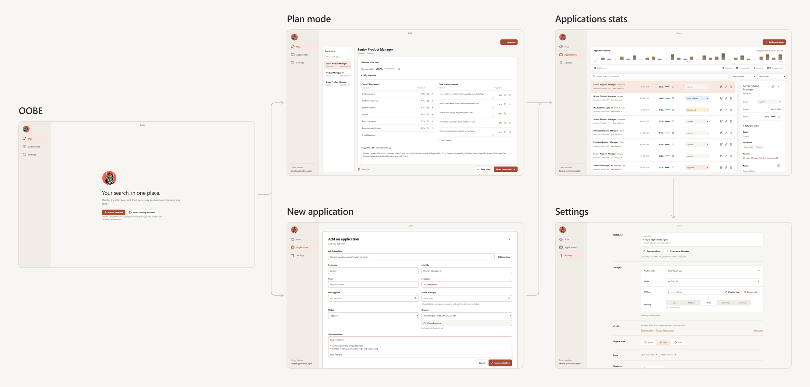

# Zebby

**Plan roles. Track applications. Keep your CVs straight.**

I built Zebby while organizing my own job search: reviewing roles, deciding what my resume needed, and remembering which version went where. I wanted something my peers could use without having to set up an AI toolchain. The zebra came along for moral support.

Below are the [product decisions](#product-decisions), [how I worked with AI](#working-with-ai), [what I pushed back on](#what-i-pushed-back-on), and [what I'd do next](#what-id-do-next).

**[Download Zebby](https://github.com/desigrit/zebby-the-scout/releases/latest)** · [Getting started](docs/guide.md#install) · [Report an issue](https://github.com/desigrit/zebby-the-scout/issues)

## What's included

[Explore the full-resolution flow](docs/screenshots/screen-flow.png) · [Browse individual screens](docs/screenshots/README.md)

- **Plan:** save a posting, add your resume and current summary, then review ATS keywords, resume themes, a match score and suggested edits. **Move to Applied** carries the details and existing score into Applications, without another analysis.
- **Applications:** track companies, roles, dates, locations, resumes, notes and statuses. Filter the list, see daily activity by status, and celebrate an offer with Zebby confetti.
- **Job descriptions:** keep the extracted or pasted description, and edit it as needed. It stays available after the posting closes.
- **Your files:** keep plans, applications and uploaded resumes together in a SQLite file you choose.

Keyword and theme percentages estimate importance to the job. Review AI suggestions before updating your CV.

## Choose how to analyze

| Option | What you use |
| --- | --- |
| **Bring your own key** | Your OpenAI or Anthropic API key. Usage is billed to your provider account. |
| **Run a local model** | Your Ollama server, or a model downloaded in Settings. Downloaded models run on CPU and work offline once installed. |
| **Buy Zebby credits** | Online analysis with GPT-6.1 Sol or GPT-6 Luna. Packs of $20 or more also unlock GPT-6 Astra. No API key or Zebby account needed. |

Bring your own key: Settings preview

Choose your provider, model and supported thinking level. Keys stay on this computer.

## Product decisions

### Give each score a specific meaning

In one comparison, a larger local model gave my resume a 62% match and a small model gave it
90% for the same role. That was enough to question the score. It wasn't enough to establish
which model was right, or whether either number was useful.

I had already separated **importance to the job** from **evidence in the resume**. An essential
requirement should appear even when the resume does not demonstrate it. Missing evidence is
a gap in the document, not proof that the person lacks the skill. The match explanation has
to identify supporting experience and gaps.

This also sets a boundary on the product's claims. Importance percentages are independent
estimates, not scores from an employer's ATS. Match strength is a directional assessment of
the supplied resume, not a probability of getting hired. The full-model scores remain
uncalibrated across models. [Analysis contract](desktop/analysis-contracts.ts)

### Narrow the task when the model cannot support the full experience

The compact SmolLM2 mode has a different contract. Code identifies listing terms and computes
keyword coverage; the model is asked for a limited wording edit using the supplied evidence.
The explanation explicitly says that this mode does not assess experience depth or hiring
likelihood. Other models retain the full analysis rather than silently falling back to this
score.

That makes an offline option possible on modest hardware, at the cost of a shallower
assessment. A high keyword-coverage score and a high full-analysis score do not mean the same
thing. The distinction belongs in the result a person reads.
[Compact-model behavior](desktop/basic-local-analysis.ts)

### A useful rewrite may leave the original alone

I asked for an explanation when the suggested summary came back unchanged. Keeping good text
can be a valid result; generating different wording is not evidence of improvement.

The analysis instructions require the model to preserve the user's voice and avoid inventing
experience, accomplishments or credentials. In compact mode, additional checks can reject a
suggestion and retain the current summary. These constraints can also reject useful edits,
and they do not guarantee factual accuracy. I would evaluate supported improvements and
unsupported additions separately. [Rewrite instructions](desktop/analysis-contracts.ts) ·
[Compact-mode checks](desktop/basic-local-analysis.ts)

### Fix the credit reservation before changing the model

I hit a confusing failure myself: roughly 90% of my credits remained, but Astra couldn't start.
The service reserved enough for a large maximum response. The purchase page's illustrative
analysis count made this look like a limit on runs.

I wanted to preserve the selected model and thinking level. We changed quotes to count the
complete input, including instructions and the response schema, and use separate output
budgets for a match check and a full Plan. Actual usage is charged after a successful
analysis; unused reservations are released.

The tradeoff remains: enough credit must be available before a request starts, and a response
can exhaust its output budget. Those failures have explicit handling. I also chose to unlock
Astra with a $20-or-higher purchase and make that condition visible before purchase and in
Settings. [Budget and settlement tests](tests/credit-budgets.test.mjs)

### Removing signup moved complexity into recovery

I initially considered login for paid analysis, then asked whether people could buy credits
without another account. We shipped a guest wallet with device credentials, a recovery code
and temporary codes for connecting another computer.

That removes a step at checkout but puts more responsibility on recovery. Lose every connected
device and the recovery code, and automatic recovery is unavailable. A failed connection must
preserve existing access, and a retry must not charge twice. Wallet credentials stay outside
the applications database, so sharing that file does not share the ability to spend credits.
[Wallet and recovery tests](tests/guest-wallets.test.mjs)

### Let people keep working while inference runs

Early analysis flows locked the window, and navigating away could stop a match calculation.
I asked to protect the listing being analyzed while letting me work on another one.

Analysis now outlives the page displaying it. Results stay attached to their original record,
duplicate requests are prevented, and a late result cannot overwrite a changed Plan.
Cancellation has a boundary too: once saving has committed, the app delivers that result.

I also asked for **Move to Applied** to carry the existing score and explanation forward.
Changing workflow state should not require paying for the same analysis again.
[Background-analysis tests](tests/background-analysis.test.mjs) · [Plan transfer](desktop/store.ts)

## Working with AI

I built Zebby with Codex, which wrote much of the implementation and test code. I supplied
the workflow, tried the builds in my own job search, and turned failures and disagreements
into specific requirements.

For the redesign, I asked for several interactive concepts before implementation. I combined
the Applications and Settings structure from one with the Plan structure from another.
For analysis, I specified what each result should mean, what evidence it could use and what
must happen when the model did not produce a useful change.

I distinguish two kinds of verification: software tests can check that a result is saved to
the right job and charged once; evaluating model judgment requires checking the result against
the resume, the role and human judgments. Passing the first does not establish the second.

## What I pushed back on

- **A cleaner concept that dropped useful fields.** I kept the existing New Application form
  when a redesign removed information the workflow needed.
- **A pricing model built around a generic input assumption.** I challenged the initial
  20,000-input-token estimate and asked for a baseline from my saved jobs and resume. The
  resulting estimates distinguish source text from an allowance for reasoning tokens, which
  those records did not contain.
- **An unchanged summary with no explanation.** I asked the model to explain why it retained
  the text or what it changed, rather than making the user guess whether analysis had worked.
- **Paying again for an administrative step.** I asked for the existing analysis to move with
  a Plan when it becomes an application, and for navigation to stop canceling paid work.

## What I'd do next

I'd start with a small, consented evaluation set of resumes and roles, with human judgments
about demonstrated requirements, missing evidence and useful edits. I'd compare unsupported
claims, missed requirements and run-to-run variation across models, keeping separate cases
for tuning and evaluation. The 62%/90% observation motivates that work; it is not a benchmark.

I would assess compact keyword coverage separately from full resume analysis, then test
whether a sourced explanation of evidence and gaps helps people more than the headline
percentage. That could change what the product displays, including whether to retain a score.

I'd also test recovery and insufficient-credit flows with people who did not build the app.
The current tests check behavior and data preservation; they do not establish whether someone
understands the next step or finds the advice useful.

## Keep your data with you

Put your SQLite file in a cloud synced folder if you use more than one PC. **Quit Zebby and let syncing finish before switching computers.** Cloud drives cannot merge simultaneous database edits.

Downloaded-model analysis runs on your computer. Online methods send the selected job and CV content to your chosen provider. API keys, wallet access and downloaded models stay outside the shared database.

Zebby checks for updates and offers **Restart to update** when a verified download is ready. For Windows and Mac installation prompts, see the [installation notes](docs/guide.md#install).

Dark mode

## Under the stripes

Electron, React, TypeScript, SQLite and a native inference engine.

[User and build guide](docs/guide.md) · [Host your own credits service](credits-service/README.md) · [Ideas and bugs](https://github.com/desigrit/zebby-the-scout/issues)
