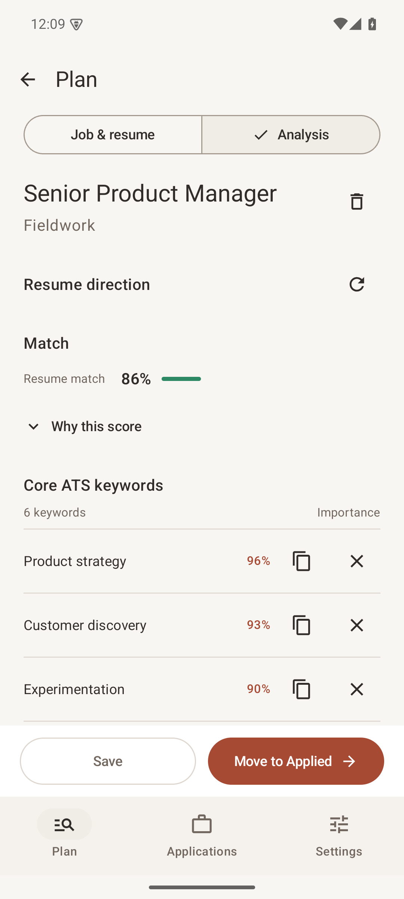
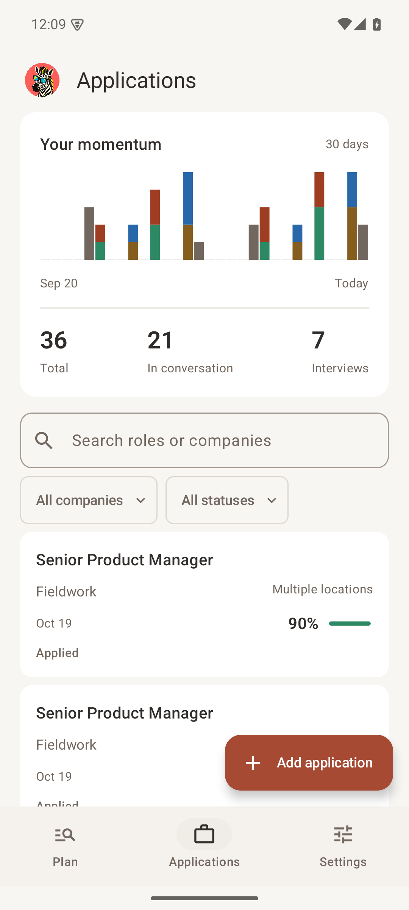
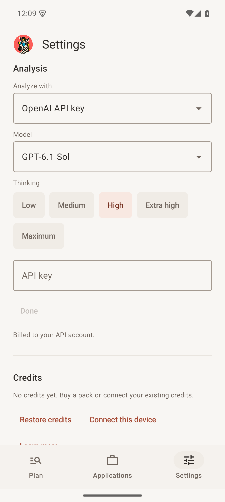

# Zebby for Android

A native Kotlin and Jetpack Compose companion to Zebby for Windows and Mac, in the same repository. This is an installable **Android preview**, not a stable release or a Play Store submission.

## A look inside

<p>
  
  
  
</p>

Synthetic sample data. [Tablet layout](../docs/screenshots/android/tablet-applications.png).

## What is included

- Plan, Applications and Settings, with Ember light and dark themes.
- Phone navigation and tablet navigation rail with an application inspector.
- Job extraction, reusable PDF/DOCX/text resumes, editable summaries, ATS keywords, resume themes, match explanations and per-item copy.
- Move to Applied reuses the existing score and resume. All application fields remain optional.
- Search, company/status filters, notes, recent locations and a 30-day stacked activity chart.
- OpenAI and Anthropic keys, an Ollama server, and the existing Zebby guest credit wallet and checkout service.
- Background analysis with progress, cancellation and a notification. Only the analyzed record is protected; other screens remain available.
- SQLite import/export and explicit cloud sync with conflict checks and retained recovery copies.

Models that run directly on the phone are deferred. There is no automatic application updater in this preview.

## Install the preview

Android 8.0 or newer is required. Transfer `app-debug.apk` to your phone, open it and allow installation from that source when Android asks. The preview uses `com.desigrit.zebby.debug`, so it can coexist with a future stable build.

The preview is signed with the build computer's development certificate. Rebuilding elsewhere may produce a different certificate. Export your database and save your credits recovery code before uninstalling or changing signing certificates. Android removes private app data on uninstall.

## Use your desktop database

Zebby uses desktop database schema **10**, including embedded resume files. Open an older database in current desktop Zebby before importing it.

1. Close Zebby on your computer and let OneDrive finish syncing.
2. On Android, open **Settings > Database > Connect cloud folder**. Choose the OneDrive folder, then your SQLite file.
3. Work on the private copy held by Android.
4. Choose **Save to cloud** before switching devices. Wait for completion and for OneDrive to sync on the computer.
5. After desktop changes, close desktop Zebby, wait for OneDrive and choose **Load from cloud** on Android.

**OneDrive support depends on the Android file provider.** It must expose folder selection, sibling creation and rename. Those capabilities have been tested with a synthetic DocumentsProvider, not a real OneDrive account. If OneDrive does not offer the folder or the required capabilities, use **Import** and **Export copy** to transfer the database explicitly. Full direct OneDrive integration would need a Microsoft Graph app registration and a separate authentication flow.

A cloud drive cannot merge simultaneous SQLite edits. If the cloud file changed, Zebby stops rather than overwriting it. Export the phone's copy before loading the other version. The preview does not merge conflicting rows.

### What sync changes

Import only reads the source. Cloud save uploads and verifies a sibling first, checks that the original is unchanged, retains the old file as `*-before-Android-*.sqlite`, then gives the verified copy the original filename. A small local journal supports recovery if a rename is interrupted. No cloud delete operation is used. Some providers may show the retained version as a rename in their activity feed.

Keep recovery copies until you have checked the new database. Cloud provider operations are not an atomic cross-device transaction, so keep Zebby closed on other devices during sync. Previous local workspaces are also retained under **Saved on this device**.

## Analysis

Choose a method in Settings. Personal keys and wallet credentials are encrypted with Android Keystore and excluded from Android backup. They never enter the shared SQLite file or diagnostic logs.

For Ollama, enter the computer's LAN or private-network address, for example `http://192.168.1.20:11434`. `localhost` on the phone refers to the phone. Your server must accept the phone's connection. Use a trusted private network; do not expose an unauthenticated Ollama port to the public internet. HTTPS is required for credentialed provider requests.

Model choices, supported thinking levels, prompts and response schemas are exported from the existing desktop sources. The app never substitutes a weaker provider silently. Unsupported thinking controls stay hidden. Malformed results are rejected instead of inventing a score.

Paid analysis starts only when you choose Analyze or refresh. Quotes and reservations use the existing backend. A durable request receipt recovers a completed result after a lost response without a second charge. Recover a pending paid result before editing or deleting its source. Real payments and paid inference have not been exercised from the Android build.

Job extraction currently covers Greenhouse, structured JobPosting data and readable page content. Some sites block automated reading or render their description only in JavaScript; paste the description when extraction cannot retrieve it. The complete set of desktop site-specific adapters is not yet ported.

## Build

Install Android Studio, JDK 17 and Android SDK 36. Let Android Studio create the ignored `local.properties`, or set `ANDROID_HOME` to your SDK.

```sh
# From the repository root, with Node 22.18 or newer
node scripts/export-android-contracts.mjs
cd android
./gradlew testDebugUnitTest lintDebug assembleDebug assembleRelease
```

- Installable preview: `app/build/outputs/apk/debug/app-debug.apk`
- Unsigned optimized build: `app/build/outputs/apk/release/app-release-unsigned.apk`
- Tests: `app/build/reports/tests/testDebugUnitTest/index.html`
- Lint: `app/build/reports/lint-results-debug.html`

The Android GitHub workflow checks shared-contract drift, tests, lint and both builds. Its preview artifact is retained for one day to limit Actions storage. GitHub's artifact download wraps files in a ZIP; the APK inside is the Android installer. A future release should attach the APK directly as a release asset.

### Stable distribution

Before a public stable release, create and securely back up a dedicated Android signing key, configure release signing through private CI secrets, and use that certificate for every update. Do not commit keys or passwords. Validate OneDrive on a physical phone, test an actual provider analysis and checkout, and check the hardware keyboard, gestures, accessibility and background behavior on the devices you support. Play Store distribution also requires its own billing and policy review; this preview targets direct APK distribution.

## Verification

Automated tests use synthetic records, resumes and provider responses. They cover optional applications, desktop-compatible persistence, score reuse, source invalidation, read-only import, cloud conflicts, interrupted replacement, durable wallet connections, paid-result recovery and cancellation. Emulator tests cover the screen flow, saving a blank application and finishing an Ollama analysis after switching to Settings.

Visual evidence is captured from an Android 15 ARM64 emulator at phone, tablet and dark/large-font sizes. This is not physical-device certification. No personal database, real API key or charge is used by the tests.
