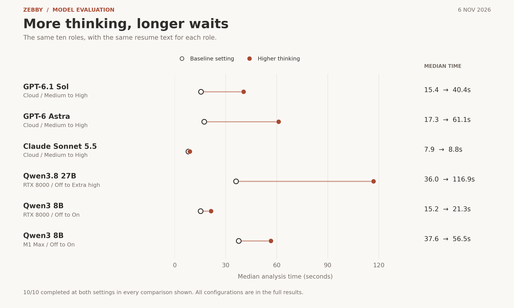
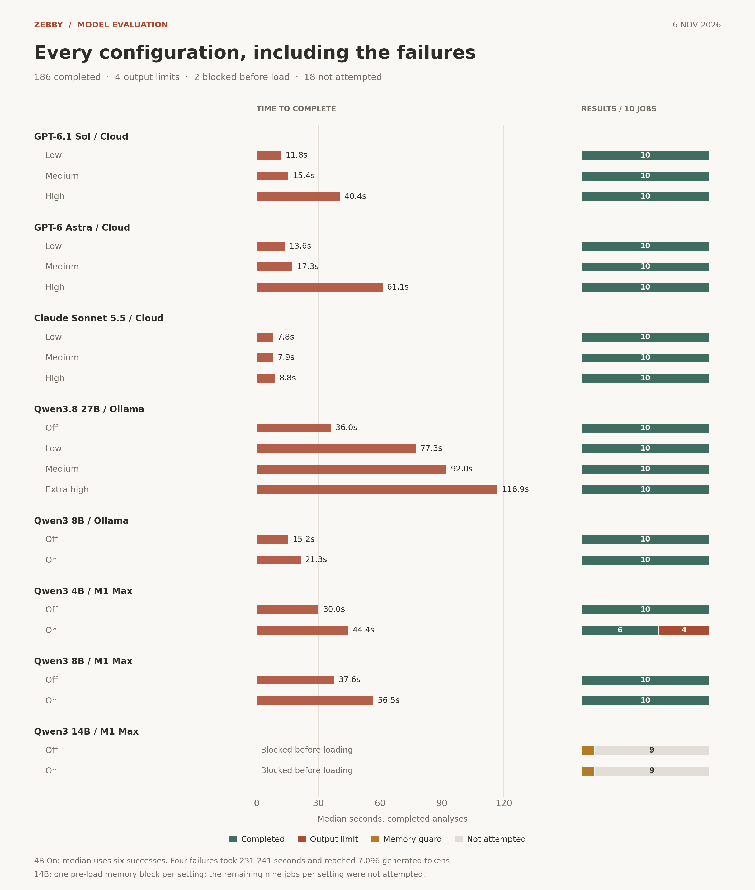

# Zebby model evaluation

**6 November 2026 · Zebby 2.9.2**

Does a stronger model, or more thinking, make resume advice more useful? I compared cloud APIs, a remote GPU and an M1 Max on Zebby's full Plan task: match score and explanation, ATS keywords, resume themes, and a summary rewrite.

## Test set

- **Ten saved PM roles**, using one candidate's resume variants. The roles covered search, AI marketplaces, enterprise risk, lending, growth, developer monetization, technical partnerships, streaming and commerce. Each job's description, resume text and current summary stayed fixed across configurations.
- **21 configurations, 210 planned analyses.** Sol 6.1, Astra 6 and Sonnet 5.5 at Low, Medium and High; Ollama Qwen3.8 27B at Off, Low, Medium and Extra high; Ollama Qwen3 8B and downloaded Qwen3 4B, 8B and 14B at Off and On.
- **Two local systems:** NVIDIA Quadro RTX 8000 with 48 GB VRAM through Ollama 0.40.3; Apple M1 Max with 32 GB unified memory through llama.cpp and Metal. Local models used Q4_K_M quantization.

One generation per executed job/configuration. Completion and latency cover every attempt. Codex checked selected explanations and rewrites against the source text; there are no independent human accuracy ratings.

## Hypothesis

Larger models should distinguish transferable skills from missing domain experience. More thinking should improve that distinction and keep rewrites faithful to the resume. Local inference should make the task practical without leaving model memory occupied after use.

## Outcomes

### More thinking did not consistently improve the advice

Sol Medium was the strongest practical starting point in the reviewed examples. It distinguished skills listed on a resume from demonstrated ownership, with a **15.4-second median**. Astra Medium made similarly careful distinctions at **17.3 seconds**. High increased their medians to **40.4 and 61.1 seconds**, without a consistent improvement in the reviewed outputs.

Sonnet was fastest at roughly eight seconds, but some rewrites overstated experience. Qwen3.8 27B caught major domain gaps, yet extra thinking did not reliably eliminate factual errors.

### A complete answer can still be wrong

| Observation | What it changes |
| --- | --- |
| Mac 4B with thinking Off scored all ten roles **92-95%**, including roles with substantial domain gaps. | A high score alone cannot establish a useful match assessment. |
| Mac 8B with thinking On identified missing risk or lending experience, then added that experience to the rewritten summary. | Check consistency between the explanation and the rewrite, as well as support in the resume. |
| Sonnet Medium and 27B Extra high sometimes promoted a billing skill into an ownership claim. | A skills-list mention should not become an accomplishment without supporting evidence. |
| 27B Medium changed a sign-in metric into a sign-up metric; Extra high preserved the original. | Thinking can fix a specific error without making every output more reliable. |
| Ollama 8B Off gave 16 of 20 keywords and all five themes the same 95% importance for one role. | Relevant keywords still need useful prioritization. |

### Completion and memory behavior were separate issues

All **90 cloud** and **60 Ollama** analyses completed. Mac 4B and 8B completed **36 of 40**. Four 4B thinking runs reached the **7,096-token output cap** after 231-241 seconds. Memory pressure stayed normal during those failures.

14B was blocked before loading at both settings because available memory was below Zebby's loading threshold. The remaining 18 jobs were not attempted. This pass produced no 14B quality or speed result.

Metal offloaded all **37 layers** for the Mac's 4B and 8B models. All **four Mac** and **six Ollama** idle checks found the tested model released after 40 seconds. No Mac inference workers remained at shutdown.

**My recommendation from this pass:** Sol Medium online; 8B Off as the practical M1 Max baseline. I would test 14B with more free memory, then add repeated runs and blind human review before setting a broader quality ranking.

Method and data

The benchmark used [Zebby's Plan instructions and schema](https://github.com/desigrit/zebby-the-scout/blob/4c3115940c742091de31fa91278e9afbbd350994/desktop/analysis-contracts.ts) at commit `4c3115940c74`. Inputs were extracted text, not document images.

Latency measures the analysis call through result validation. It excludes cloud token-count preflight and includes local loading when needed. Local calls include both warm and cold starts. The Mac and Ollama 8B packages differ, so their timings compare configured systems rather than hardware alone.

Thinking settings retain Zebby's output budgets and sampler defaults. Cloud limits were 6,000 / 16,000 / 24,000 tokens for Low / Medium / High. Local limits were 3,000 with thinking Off and 7,096 with thinking enabled. This evaluates shipping configurations, not an isolated change to reasoning effort.

[Aggregate results (CSV)](results.csv) · [Method, model identities and aggregates (JSON)](results.json) · [Vector timing chart](thinking-time.svg) · [Vector full results](full-results.svg)

Rebuild both figures with `python -m pip install -r requirements.txt` and `python render.py` from this directory. The script reads only the published aggregates and makes no model calls.

